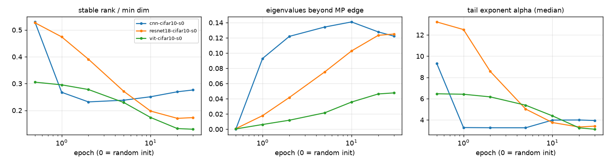
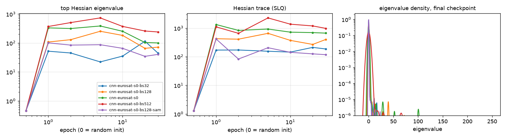
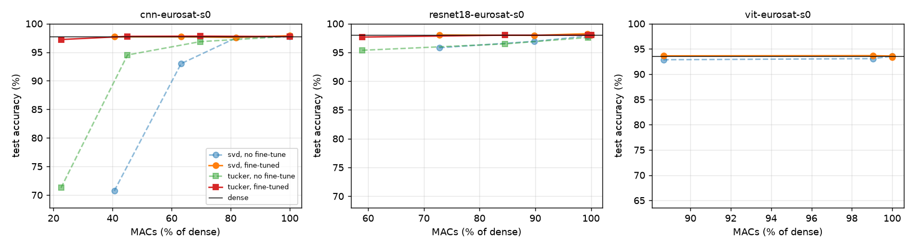
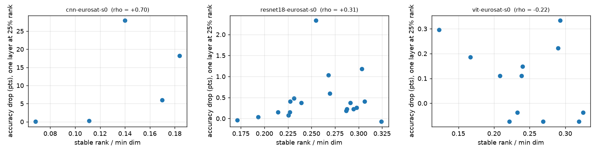

# SpectraLens

A linear-algebra lens on vision networks.

SpectraLens is a research-style project that looks at image classifiers through their
matrices: the singular values of their weights, the eigenvalues of their loss Hessian, and how
much of each layer can be thrown away with a low-rank approximation before accuracy drops.

All of the numerical linear algebra is written from scratch in PyTorch (power iteration,
Lanczos, randomized SVD, stochastic trace estimation, Hessian-vector products) and checked
against `torch.linalg` / SciPy before it is used on real models.

> Status: early work in progress. The sections below describe the plan; results will be added
> as each part lands.

## Questions

1. **Weight spectra.** How do the singular-value spectra of conv and linear layers evolve during
   training, and how far do they drift from a random (Marchenko-Pastur) baseline?
2. **Curvature.** What does the Hessian eigenspectrum of a trained CNN look like, and how do the
   top eigenvalues change with batch size and with sharpness-aware training (SAM)?
3. **Compression.** How much accuracy is lost per FLOP saved when layers are replaced by their
   truncated SVD (linear) or Tucker (conv) factorizations, and does the spectrum predict which
   layers are safe to compress?

## Linear algebra toolkit

`spectralens.linalg` works on dense tensors or on any matrix-free `LinearOperator`
(a function `v -> A @ v`), so the same code runs on a weight matrix or a network Hessian.

| Routine | What it does |
|---|---|
| `power_iteration` | top-k eigenpairs by magnitude, with implicit deflation |
| `lanczos`, `lanczos_eigsh` | Krylov tridiagonalization with full reorthogonalization and breakdown detection; extreme Ritz pairs (`LA` / `SA` / `LM`) |
| `randomized_svd` | Halko-Martinsson-Tropp range finder with oversampling and power iterations |
| `hutchinson`, `hutchpp` | stochastic trace estimation (Rademacher / Gaussian probes), Hutch++ |
| `hessian_operator` | Hessian-vector products by double backprop, never forming the Hessian |

Every routine is tested against `torch.linalg` or SciPy (including `scipy.sparse.linalg.eigsh`
on a sparse Laplacian), and the randomized SVD error is checked against the HMT 2011 bound
with Hypothesis-generated matrices.

Benchmark on a 4096 x 4096 float32 matrix, RTX 5070 Ti Laptop GPU
(`python scripts/bench_linalg.py --device cuda`):

| Method | Time (ms) | Error |
|---|---:|---:|
| full SVD (`torch.linalg.svd`) | 5633.6 | 1 |
| randomized SVD, rank 64, q=0 | 5.5 | 2.67 |
| randomized SVD, rank 64, q=2 | 8.6 | 1.02 |
| dense `torch.linalg.eigvalsh` | 248.0 | 4.8e-6 |
| Lanczos top-10, 60 steps | 28.4 | 3.8e-6 |

SVD error is the spectral-norm residual divided by the optimal one, sigma_65 (1.0 means
optimal), on a spectrum sigma_i = 1/i. Eigenvalue error is the largest absolute error of the
top 10. Two power iterations bring the randomized SVD within 2% of optimal while staying
about 650x faster than the full decomposition.

## Data

`spectralens.data` builds leakage-free splits for the two datasets used in the experiments:

| Dataset | Train | Val | Test | Split |
|---|---:|---:|---:|---|
| EuroSAT RGB (64x64, 10 classes) | 21,600 | 2,700 | 2,700 | stratified 80 / 10 / 10, seeded |
| CIFAR-10 (32x32, 10 classes) | 45,000 | 5,000 | 10,000 | official test set, train split 90 / 10 |

- Normalization statistics are computed on the train split only (float64 accumulation) and
  cached per seed. On CIFAR-10 they come out as mean (0.4914, 0.4822, 0.4466) and std
  (0.2470, 0.2435, 0.2616), matching the commonly quoted values.
- Augmentation only touches the train view: flips and 90-degree rotations for EuroSAT (overhead
  imagery has no "up"), random crop + flip for CIFAR-10.
- Decoded images are kept in RAM as one uint8 tensor and cached on disk. On EuroSAT that took
  the single-worker loader from ~1,000 to ~4,000 images/s and split building from 27 s to 0.2 s.
- `fixed_subset` gives a small, class-balanced, always-identical subset for Hessian estimates.

```bash
python -m spectralens data eurosat --download   # or: cifar10
```

## Training

Three architectures, trained from scratch for 30 epochs with SGD + Nesterov (lr 0.1, 0.05 for the
ViT), 1-epoch warm-up then cosine decay, weight decay 5e-4 except on biases and norm layers,
bf16 autocast. Checkpoints are kept at epochs 0 (random init), 1, 2, 5, 10, 20 and 30 for the
spectral analysis; every run is logged to MLflow.

```bash
python -m spectralens.train model=cnn,resnet18,vit data=eurosat,cifar10   # 6 runs
```

| Model | Params | EuroSAT test acc | CIFAR-10 test acc |
|---|---:|---:|---:|
| Small CNN (3 VGG blocks) | 0.29 M | 97.78% | 88.64% |
| ResNet-18 (3x3 stem, no max-pool) | 11.2 M | **97.96%** | **92.30%** |
| Tiny ViT (6 blocks, dim 192, 64 tokens) | 1.8 M | 93.56% | 78.08% |

On an RTX 5070 Ti laptop GPU an epoch takes 3-17 s (ResNet-18 on CIFAR-10 is the slowest at
~17 s), so all six runs fit in well under an hour. The ViT trails both CNNs, as expected for a
small transformer without pre-training or heavy augmentation on 20-45k images.

Hydra's `@hydra.main` CLI doesn't work on Python 3.14 (it hands argparse a non-string help
object), so the trainer uses Hydra's compose API and expands `key=a,b` sweeps itself.

## Weight spectra

`python -m spectralens.spectra` takes every checkpoint, turns each weight into a matrix (conv
kernels flattened to out x in·k·k, attention's packed q/k/v split), and measures its singular
value spectrum:

- **stable rank** ||W||²_F / ||W||²₂ (as a fraction of the smaller dimension)
- **outliers**: eigenvalues of W Wᵀ / n above the Marchenko-Pastur bulk edge σ²(1 + √q)², i.e.
  structure that i.i.d. noise of the same variance can't produce
- **tail exponent α**: Hill estimate on the top 10% of eigenvalues (smaller = heavier tail)

| Run | Stable-rank ratio (init → end) | Beyond MP edge | α (median) |
|---|---|---|---|
| CNN, EuroSAT | 0.53 → 0.19 | 0.0% → 15.0% | 9.3 → 3.1 |
| CNN, CIFAR-10 | 0.53 → 0.28 | 0.0% → 12.2% | 9.3 → 3.9 |
| ResNet-18, EuroSAT | 0.53 → 0.27 | 0.1% → 7.6% | 13.2 → 4.6 |
| ResNet-18, CIFAR-10 | 0.53 → 0.17 | 0.1% → 12.5% | 13.2 → 3.4 |
| ViT, EuroSAT | 0.30 → 0.20 | 0.3% → 2.4% | 6.3 → 5.2 |
| ViT, CIFAR-10 | 0.31 → 0.13 | 0.0% → 4.8% | 6.5 → 3.1 |



- At initialization every network matches the random-matrix prediction (essentially no
  eigenvalues past the MP edge), which is a good sanity check of the measurement itself.
- Training concentrates the weights: stable rank drops by roughly half, 5-15% of eigenvalues
  leave the bulk, and the tails get heavy (α ≈ 3-4.6 for the CNNs, in the range Martin & Mahoney
  associate with well-trained layers).
- The small CNN gets most of its structure in the first epoch; ResNet-18 and the ViT build it
  gradually over training.
- The ViT moves least, matching its weaker accuracy, which makes it the interesting case for the
  compression phase: low-rank structure is what truncated SVD can exploit.

## Loss curvature (Hessian)

`python -m spectralens.hessian` measures the curvature of the training loss at every checkpoint
without ever forming the Hessian (290K x 290K for the small CNN):

- **λ_max**: top eigenvalues by Lanczos on Hessian-vector products (double backprop).
- **trace and eigenvalue density**: stochastic Lanczos quadrature. Each Rademacher probe gives a
  Gauss quadrature rule (nodes = Ritz values, weights = squared first components of the Ritz
  vectors); averaged over probes and smoothed with a Gaussian, that's the spectral density.
- The Hessian is of the mean loss over a fixed, class-balanced set of 512 un-augmented training
  images, with the model in eval mode, and is recomputed batch by batch on every product so
  memory stays at one batch.

The experiment: the small CNN on EuroSAT, same recipe (SGD + Nesterov, lr 0.1, cosine, 30
epochs), only the batch size changes, plus one run with SAM (ρ = 0.05) at batch 128.

| Run | λ_max (final) | Trace (final) | Test accuracy |
|---|---:|---:|---:|
| batch 32 | 44.5 | 187 | **98.30%** |
| batch 128 | 72.0 | 402 | 98.26% |
| batch 256 | 100.7 | 669 | 97.78% |
| batch 512 | 240.7 | 980 | 97.11% |
| batch 128 + SAM | **40.5** | **118** | 97.89% |



- **Bigger batches end in sharper minima.** From batch 32 to 512 the top eigenvalue grows 5.4x
  and the trace 5.2x, monotonically, and test accuracy drops 1.2 points: the
  Keskar et al. (2017) picture, reproduced on a small scale.
- **SAM does what it's designed to do to the curvature:** at the same batch size it lowers
  λ_max by 44% and the trace by 71%, to below the batch-32 run. Here that did *not* buy
  accuracy (-0.37 points vs plain batch 128), so on EuroSAT, where every run is already at
  97-98%, flatness and generalization are correlated across batch sizes but not causally
  linked through SAM. One seed per run, so differences under ~0.3 points are within noise.
- Curvature jumps from ~0.5 at initialization to its peak within the first epoch or two, then
  relaxes as the learning rate decays.

Cost: about 110 Hessian-vector products per checkpoint (30 Lanczos steps + 2 SLQ probes x 40
steps), ~72 s on a laptop RTX 5070 Ti. cuDNN has no fast kernels for the convolution double
backward, which is what dominates; 35 checkpoints took 43 minutes.

## Low-rank compression

`spectralens.compress` swaps trained layers for factorized ones:

- **Truncated SVD** (best rank-r approximation by Eckart-Young-Mirsky): a Linear becomes two
  Linears through an r-dim bottleneck, a k x k conv becomes a k x k conv to r channels plus a
  1x1 conv. A test checks the rank-r spectral error equals the (r+1)-th singular value.
- **Tucker-2** (HOSVD on the output- and input-channel modes): a k x k conv becomes
  1x1 (in -> r_in), k x k core (r_in -> r_out), 1x1 (r_out -> out). Exact at full ranks and on
  kernels with a planted low multilinear rank.
- Ranks keep a fraction of the squared singular values ("energy"); a layer is only replaced
  when the factorization is actually smaller. The RGB stem, 10-way heads and attention's
  functionally-called projections stay dense. MACs are counted from one forward pass with
  hooks (convs, linears, and attention including QK^T and AV).

`python -m spectralens.compress.run` sweeps energy 0.80 / 0.90 / 0.95 / 0.99 on the final
EuroSAT checkpoints, scores on the test split, then fine-tunes 2 epochs (SGD, lr 0.01, cosine)
and scores again:

| Model | Method, energy | MACs | Params | Test acc, no fine-tune | Test acc, 2-epoch fine-tune |
|---|---|---:|---:|---:|---:|
| CNN (dense: 97.78%) | Tucker-2, 0.90 | **45.1%** | 49.5% | 94.52% | **97.78%** |
| | Tucker-2, 0.80 | 22.6% | 22.5% | 71.26% | 97.22% |
| | SVD, 0.80 | 40.6% | 40.0% | 70.74% | 97.70% |
| ResNet-18 (dense: 98.00%) | Tucker-2, 0.80 | **58.9%** | 60.6% | 95.37% | 97.67% |
| | SVD, 0.80 | 72.8% | 74.8% | 95.81% | 98.04% |
| | Tucker-2, 0.90 | 84.5% | 85.3% | 96.48% | 98.00% |
| ViT (dense: 93.56%) | SVD, 0.80 | 88.7% | 87.9% | 92.85% | 93.63% |



- **Tucker-2 beats plain SVD on convs** at every budget: it compresses both channel modes
  instead of folding the spatial kernel into one side.
- **Two epochs of fine-tuning recover almost everything**: the CNN keeps its full accuracy at
  45% of the MACs, ResNet-18 loses 0.33 points at 59%. (Fine-tuning the *dense* models the same
  way moves them by at most +0.1 points, so this is recovery, not extra training.)
- **The ViT barely compresses.** At 95% energy no factorization is smaller than the dense layer:
  its weights are close to full rank, which matches the weight-spectra section (its spectra
  moved least during training).

**Does stable rank predict which layers tolerate compression?** Each eligible layer was cut to
25% of its rank on its own (no fine-tuning) and the accuracy drop compared with the layer's
stable rank ratio:

| Model | Layers | Spearman ρ (drop vs stable rank) |
|---|---:|---:|
| CNN | 5 | +0.70 |
| ResNet-18 | 19 | +0.31 |
| ViT | 12 | -0.22 |



Only weakly, and not on the ViT. The direction is the expected one on the CNNs (low stable rank,
smaller drop) but with 5-19 layers per model and ρ around 0.3 on ResNet-18 it's not a rule one
could pick ranks by; where a layer sits in the network (early convs, the downsampling path)
matters at least as much as its spectrum.

## Report

[`paper/main.pdf`](paper/main.pdf) (9 pages) writes the three experiments up as a
short paper: the toolkit with the guarantees it relies on (Eckart-Young-Mirsky, the
Halko-Martinsson-Tropp randomized SVD bound, Kaniel-Paige-Saad convergence for Lanczos,
Hutchinson / Hutch++ variance, SLQ as Gauss quadrature, Pearlmutter's Hessian-vector product),
the Marchenko-Pastur baseline for the weight spectra, all result tables and figures, and a
limitations section (one seed per run, Hessian in eval mode on 512 images, uniform rank
thresholds).

```bash
tectonic paper/main.tex            # https://tectonic-typesetting.github.io, fetches packages itself
```

Figures are read straight from `reports/figures/`, so re-running an experiment and rebuilding
updates the paper.

## Tests

```bash
pytest --cov                     # 111 tests, ~98% line coverage, fails under 95%
```

- **Numerics** are checked against `torch.linalg` / SciPy (including `eigsh` on a sparse
  Laplacian), against closed forms (Eckart-Young error of a truncated layer, exact SLQ on small
  matrices, Tucker-2 on a planted low multilinear rank kernel) and with Hypothesis-generated
  matrices against the randomized SVD error bound.
- **End to end on CPU** (`tests/test_pipeline_e2e.py`): `build_datasets` is swapped for one that
  builds the same splits from torchvision's FakeData, then the real scripts run in sequence -
  train 2 epochs, weight spectra, Hessian, compression sweep, the `data` / `info` CLI - and their
  JSON reports and figures are checked. About 20 s, no dataset or GPU needed.

Writing those end-to-end tests turned up two real problems: the compression script fine-tuned with
a hard-coded batch of 256, and on a split smaller than one batch the training loop divided by
zero (it now raises a clear error and the batch size is a flag); and a module-scoped fixture set
up before the function-scoped data patch had the "fake" test silently training on the real
EuroSAT for two minutes.

## Planned layout

```
src/spectralens/
  linalg/     power iteration, Lanczos, randomized SVD, trace estimators, HVPs
  data/       EuroSAT + CIFAR-10 loaders
  models/     small CNN, ResNet-18, tiny ViT
  analysis/   weight spectra, Hessian spectra, rank metrics
  compress/   SVD / Tucker factorized layers, LoRA
configs/      Hydra experiment configs
paper/        LaTeX write-up
tests/        unit + property-based tests
```

## Setup

Requires Python 3.11+.

```bash
python -m venv .venv
# Windows: .venv\Scripts\activate
source .venv/bin/activate
pip install -e ".[dev]"
python -m spectralens info
```

For GPU training install a CUDA build of PyTorch first, following the selector on
[pytorch.org](https://pytorch.org/get-started/locally/).

## License

MIT
